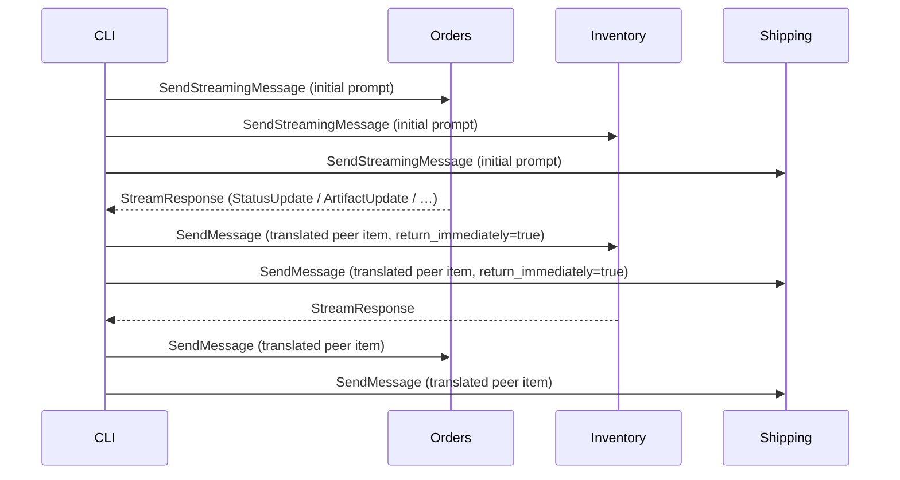

# Collaborative task extension

The collaborative task extension lets multiple A2A agents work on the same task together. Each agent streams its responses; a relay translates those responses into new requests delivered to every other agent. All agents run simultaneously and share context, letting each react to what the others say.

This page covers the relay model, how to build an agent that participates in a collaborative session, and how to drive one with `a2acli`.

## How it works

The relay connects agents in a **mesh**: every agent sees everything every other agent says.



The relay (here the CLI) receives each `StreamResponse` from one agent, translates it into a `SendMessageRequest` using §5.1 rules, and delivers it to all other agents. That delivery is a standard `SendMessage` with `return_immediately=true` so the agent can absorb the peer item while its own stream is still running.

### Translation rules (spec §5.1)

| `StreamResponse` variant | Translated to |
|---|---|
| `Task` | `Part::data` with media type `application/vnd.a2a.task+json` |
| `StatusUpdate` with `message` | original `Message` parts + appended `Part::data` (`application/vnd.a2a.task-status-update+json`) |
| `StatusUpdate` without `message` | single `Part::data` (`application/vnd.a2a.task-status-update+json`) |
| `ArtifactUpdate` | `Part::data` (`application/vnd.a2a.task-artifact-update+json`) — v1.0 fallback |
| `Message` | pass-through parts |

The relay also:

- **Rewrites session IDs** — injects the receiving agent's `context_id` and `task_id` so the item lands in the right task.
- **Sets attribution** — adds `message-sender` metadata under the shared-task extension URI so the receiving agent knows who sent it.
- **Suppresses echo** — never routes an item back to the agent that produced it.

## Extension URIs

An agent that participates in collaborative sessions must declare two extension URIs in its `AgentCard`:

```rust
use a2a::{EXTENSION_URI_COLLABORATIVE_TASK, EXTENSION_URI_SHARED_TASK};
```

| Constant | URI |
|---|---|
| `EXTENSION_URI_SHARED_TASK` | `https://a2a-protocol.org/extensions/shared-task/v1` |
| `EXTENSION_URI_COLLABORATIVE_TASK` | `https://a2a-protocol.org/extensions/collaborative-task/v1` |

The relay checks both before starting. If either is missing the session fails with an error naming the missing URI.

## Building a participating agent

### 1. Declare the extensions in the agent card

```rust
use a2a::{
    AgentCapabilities, AgentExtension,
    EXTENSION_URI_COLLABORATIVE_TASK, EXTENSION_URI_SHARED_TASK,
};

let capabilities = AgentCapabilities {
    extensions: Some(vec![
        AgentExtension { uri: EXTENSION_URI_SHARED_TASK.to_string(), required: Some(true), ..Default::default() },
        AgentExtension { uri: EXTENSION_URI_COLLABORATIVE_TASK.to_string(), required: Some(true), ..Default::default() },
    ]),
    ..Default::default()
};
```

### 2. Accept relay messages with `FanInHandler`

The relay delivers peer items to your agent via `SendMessage` while your executor is still streaming. Without special handling those calls would start a second, parallel execution instead of routing to the running one.

`FanInHandler` (from the `examples/src/collaborate` module) intercepts `send_message` calls for tasks that have an active executor and routes them into a per-task inbox channel instead:

```rust
use examples_lib::collaborate::{fan_in::{FanInHandler, InboxRegistry}, server::run_server};
use std::sync::Arc;

// 1. Create a shared inbox registry.
let inbox = Arc::new(InboxRegistry::new());

// 2. Build the executor with a reference to it so it can register.
let executor = MyCollabExecutor::new(inbox.clone());

// 3. Build the standard handler and wrap it.
let inner = DefaultRequestHandler::new(executor, InMemoryTaskStore::new());
let handler = Arc::new(FanInHandler::new(inner, inbox));
```

Inside `execute()`, register the inbox before yielding the first event and read from it in a loop:

```rust
fn execute(&self, ctx: ExecutorContext) -> BoxStream<'static, Result<StreamResponse, A2AError>> {
    let inbox = self.inbox.clone();
    Box::pin(async_stream::stream! {
        let task_id = ctx.task().id.clone();
        let (tx, mut rx) = tokio::sync::mpsc::channel(32);

        // Register: relay messages for this task go to `tx`.
        inbox.register(task_id.clone(), tx);

        // Yield initial response …
        yield Ok(StreamResponse::StatusUpdate(/* … */));

        // Process peer items as they arrive.
        while let Some(peer_msg) = rx.recv().await {
            // React to what the peer said, yield your own response.
            yield Ok(StreamResponse::StatusUpdate(/* … */));
        }

        // Deregister before completing.
        inbox.unregister(&task_id);
        yield Ok(StreamResponse::StatusUpdate(/* completed state */));
    })
}
```

See `examples/src/collaborate/agent.rs` for a complete, deterministic example.

## Running a session with `a2acli`

Start the agents:

```bash
cargo run -q --bin collaborate-orders   &
cargo run -q --bin collaborate-inventory &
cargo run -q --bin collaborate-shipping &
```

Then run:

```bash
cargo run -q --bin a2acli -- collaborate \
  --agent http://localhost:9001 \
  --agent http://localhost:9002 \
  --agent http://localhost:9003 \
  "Customer ORD-1001 has not received their order — what is going on?"
```

Output arrives interleaved, one line per agent event:

```text
[http://localhost:9001]: ORD-1001 was shipped on 2024-01-03, tracking number TRK-9001.
[http://localhost:9002]: P-500 Wireless Headphones: oversold by 2 units — fulfillment delayed.
[http://localhost:9003]: TRK-9001 delayed — weather event in Memphis hub, estimated 2-day delay.
```

Pass `--timeout 30s` to end the session after 30 seconds even if agents are still running.

## Programmatic usage

The `a2a-collab` crate exposes the two building blocks:

```toml
[dependencies]
a2a-collab = { version = "0.1" }
```

**Pre-flight check:**

```rust
use a2a_collab::require_collaborative_extensions;

require_collaborative_extensions(&card)?;
```

**Translate a peer response:**

```rust
use a2a_collab::translate_peer_response;

if let Some(request) = translate_peer_response(
    &response,
    "orders-agent",           // sender identity
    &receiving_context_id,
    &receiving_task_id,
) {
    client.send_message(&ServiceParams::default(), &request).await?;
}
```

The crate has no transport dependency — relay callers supply their own `A2AClient`.

## Limitations

- **`ArtifactUpdate` (v1.0 fallback):** The `artifact_updates` field on `SendMessageRequest` is a v1.1 feature. Until then, `ArtifactUpdate` events are encoded as `Part::data` with media type `application/vnd.a2a.task-artifact-update+json`.
- **`TaskMessageUpdateEvent` deferred:** Translating `TaskMessageUpdateEvent` items requires v1.1 semantics and is not yet implemented.
- **SLIMRPC native mode deferred:** A SLIMRPC server-side relay using SLIM shared-responses is planned but not yet available. The current implementation is transport-agnostic (HTTP/JSON-RPC, REST).
